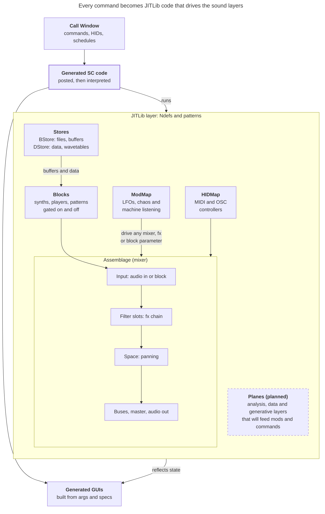
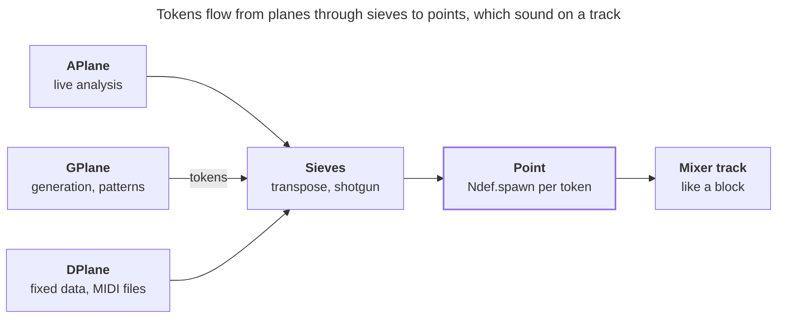

# Radicles Design Principles

Oct 24, 2026 · @Federico

## Purpose

Radicles makes live coding in SuperCollider quicker and more accessible by turning short, command-line style commands into JITLib code. It is a command-line style, highly automated, multi-layered live coding environment that combines most of what a performer needs for live electronics in one place.

It was designed for improvising with musicians playing traditional instruments, where exchange has to be fast, spontaneous and responsive. Conventional live coding often means typing long expressions, which slows down reaction to other players. Radicles keeps the modularity of live coding but cuts typing to a few words per action, so audible results come quickly.

It also serves research-led teaching. Students who have never programmed can make sound after learning a handful of commands, and they see the SuperCollider code each command produces. The same environment scales up to custom effects, blocks, modulation, machine listening and neural audio models.

Who it is for:

- Performers of live electronics who want command-line speed rather than mouse-driven software
- Live coders who want a faster vocabulary over JITLib (Ndefs and patterns)
- Improvisers working with instrumentalists, where response time matters
- Students learning live electronics and coding at the same time
- Developers and users who want to extend the system with their own effects, synths and commands

## Core principles

Fourteen commitments define Radicles; any new feature or refactor must keep all of them. The first five are foundational; the rest come from the way the system is used in performance.

1. **Every command generates code.** A command builds executable SuperCollider code as a string, posts it, then interprets it. This is the core mechanism, not an implementation detail: it keeps the system transparent, makes it live coding rather than an app, and lets users learn from the code they trigger (the `doc` command opens it). This holds for GUIs and controllers too, but posting has two channels, chosen by the kind of control: typed commands, aliases, saved command files, GUI pop-up menus and GUI buttons (or controllers mapped to menus) are structural and use `radpost` (main document, post window, OSC code sharing), while GUI sliders, knobs and text fields, and MIDI, HID and OSC controls (including toggles) use `radpostcont`, which posts to the post window only, or to a separate document, so the main document stays a readable record of the performance.
2. **Everything is open and in text.** Effects, blocks, specs, modulators, presets, settings and saved sessions live in plain text files that anyone can read, edit and extend. Nothing essential is hidden in compiled or binary form.
3. **The GUI is generated from the code.** Interfaces are derived automatically from functions and their specs, such as an effect window built from its arguments and `->` ControlSpecs. No effect, block or modulator needs a hand-built interface.
4. **Radicles is a layer on top of JITLib.** Sound is made with Ndefs and patterns; Radicles is a faster way of writing that code. New features compile down to Ndef and pattern code that could run without Radicles.
5. **Command-line speed, not traditional live coding.** Commands are short, idiosyncratic and quick to type, like shell commands. Less typing is better: few words, quick audible results, so a performer can react to other musicians in real time.
6. **Programming is not a prerequisite.** A beginner makes sound after learning a few commands, while SuperCollider remains fully available for anyone who wants to go deeper. Every layer should be reachable from both ends.
7. **Hackable with basic SuperCollider knowledge.** Anyone who knows basic SuperCollider can open any part of the system and change it: an effect, a block, a modulator, a command, or a class. Definitions are plain functions rather than framework code, so the usual way to make something new is to copy an existing one and adapt it.
8. **Physical interfaces are central.** Any parameter a command can set can also be mapped to a MIDI controller, an OSC device (TouchOSC, a phone, another application) or another HID, and any command can be triggered from one. Mapping uses the same syntax as modulation (`midicc_(19)`, `osc_(/3/fader1)`) and is saved as a preset (`hidsave`). In performance, hands on controllers matter as much as typing.
9. **Commands, controllers and windows are equal ways in.** Radicles works fully from commands alone (`nomix`), and windows such as the mixer read and visualise what is happening. No action should exist only in a GUI.
10. **Individual and global, static and dynamic controls.** A parameter can be set once or changed over time (lags, crossfades, modulation, machine listening, controllers), on one track or many at once (`1-4`, `[1,3]`). Automation of many parameters is a goal in itself.
11. **State can be saved at every level.** Presets exist for a single effect, a channel strip, controller mappings, buffers and whole sessions or projects. Musical structure is built by moving between saved states.
12. **The system explains itself.** Users should always be able to find out what exists and what is happening: listings (`ls`, `fxs`, `blks`, `mods`), parameter queries, posted code and help files. Documentation is part of the system, not an afterthought, and it is currently the area that most needs work.
13. **Users make their own vocabularies.** The system should let people build abstractions over commands and share additions as a community. In the spirit of a minority language, Radicles is not a fixed product but a vocabulary its users keep extending.

14) **Radicles is a research tool: every action can be recorded.** Everything a user does, whether typed commands, generated code, GUI moves, controller and OSC input, modulation, scheduled events or errors, can be captured with timing and context into a structured log. Logs, state snapshots and audio recordings together form datasets of user behaviour for analysis and for machine-learning and generative practice. Recording is visible, consented to and pseudonymous, in line with research ethics.

## Architecture

Radicles has one path from performer to sound: a command becomes SuperCollider code, which is posted and interpreted, and that code builds or changes Ndefs and patterns.



*Redrawn in Mermaid from the claude.ai version; the boxes and words are the same.*

Sources feed tracks in the Assemblage, where each strip runs input, effect slots and spatialisation into buses and the master. A track's source can be changed: a block is a gated synth with an on/off envelope that holds until stopped, and a point (planned) is an Ndef played with .spawn, each event a new synth with a predefined envelope and no gate or hold; ModMap and HIDMap can reach any parameter along the way. In the code, the main class `Radicles` registers the commands, `CallWindow` parses them, and `Assemblage`, `Block`, `BStore`/`Store`, `ModMap`, `HIDMap`, `Space` and the `Plane` classes implement each layer.

**Channels and panning.** Every strip has a channel mode (how many channels come in) and the system has an output channel count (how many go out). The space Ndef at the bottom of each strip is chosen from both: it turns the strip's channels into the output channels.

| Strip | In | Out | Space |
| --- | --- | --- | --- |
| Mono track or bus | 1 | 2 | `Pan2`: places a mono signal in stereo |
| Stereo track or bus | 2 | 2 | `Balance2`: balances a stereo signal |
| Master | 2 (strips arrive already panned) | 2 | `Balance2` |
| Mono track or bus | 1 | 3–8 | `Pan4` for 4, `PanAz` otherwise |
| Master | N | N > 2 | direct, no panner |

These are today's choices, not a fixed design. The channel in/out architecture needs rethinking in more detail (for example, what a stereo strip uses with more than 2 output channels); a good starting point is how Logic Pro and Ableton Live handle channel formats, panning and routing.

**Recording a performance (28 Oct).** Radicles keeps two complementary records, both kept in the design:

- **Research code log** (`RadCodeLog`; `codelog on` / `Radicles.codeLog = true`): every piece of generated code, plus code run by hand in the IDE, with its time, source (typed, menu, button, controller, slider, direct call, IDE) and channel. Off by default, saved locally in `RadiclesFiles/Logs/`. It records *what ran*.
- **Call window history** (`cW.startHistory` / `stopHistory`): the performer's keystrokes in the call window with their timing, saved in `Settings/CallWindow/History/`. It records *how it was typed*, the gesture itself, and is the natural material for replaying a session (see #45).

The older `GlobalHistory` class, which nothing called, was removed in favour of these two.

## Command language conventions

New commands should follow the patterns users already know, so the vocabulary stays guessable. These are the conventions in the current system and teaching handouts.

| Convention | Example | Meaning |
| --- | --- | --- |
| Space-separated words, numbers, arrays and ranges | `vol t 1 -10` | Command name, then arguments |
| Address by track type and number | `vol t 1 -10`, `pan b 2 0.5` | `t` track, `b` bus, `m` master |
| Address by mixer position | `vol 4 -3` | Counts all strips left to right, buses and master included |
| Several targets at once | `vol b 1-2 -inf`, `trim [1,3,5] 5` | A range or an array of tracks |
| Progressive arguments: fewer args = query | `fxset 1 1` / `fxset 1 1 1` / `fxset 1 1 1 0.5` | List parameters / get one value / set it |
| Parameters by number or by name | `blkset 1 1 0`, `blkset 1 key 5` | Either form is accepted |
| `lag` suffix | `vollag 1 10`, `fxlag t 1 10` | Glide time for later changes |
| `n` suffix | `t addn 2`, `blksetn 1 [key, 5, oct, 1]` | Many items or many parameters in one go |
| `x` infix | `blkxset 1 key 5` | Crossfade to the new value |
| `mod` / `unmod` prefix | `modblkset 1 freq [freq, 5]`, `unmodfx 1 1` | Edit or remove a modulator |
| Modulator in a value slot | `blkset 1 1 sin_(freq, 2)` | Any value can become a modulator |
| HID in a value slot | `vol 1 midicc_(19)`, `vol 1 osc_(/3/fader1)` | Controllers map like modulators |
| `@` for buffers | `@n 2 30`, `sr @1 2`, `lp 1 @1 0.5` | Create, record into, play buffers |
| `( a & b )` | `(vol 1 -inf & vol 2 0)` | Run commands at the same time |
| `( ^ cmd )`, `( 4 ^ cmd )` | `(4 ^ lt 1)` | Run on the next beat, or on beat 4 |
| `( id <> cmd % cmd )` | `(osc /3/toggle2 <> mute 1 % unmute 1)` | A controller triggers or toggles commands |
| `( name = cmd )` | `(intro = lp 1 drums1)` | A user-defined alias |
| `{ … }` | `blkset 1 key {[0, 5, 7].choose}` | Inline SuperCollider, evaluated first |

Rules for new commands:

- Keep names short (2 to 6 letters) and consistent with existing families before inventing a new one.
- Support both addressing styles, ranges and arrays wherever a command targets tracks.
- Make the shortest form a query: omitting the value should post what is there, not fail.
- Post the generated code, and give a helpful message when arguments do not match, naming the expected forms.
- Give every command a one-line description, so `ls` and help stay complete.

## Openness and extensibility

Users extend Radicles by writing plain SuperCollider functions into text files; the system turns them into commands and GUIs automatically. A user adds an effect in one statement:

```
SynthDefFile.write('filter', 'myfx', {arg volume = 0 -> [-20, 20];
	\in * volume.dbamp;
}, "my very first Radicles effect");
```

The type (`filter`, `block`), name, function, ControlSpecs after `->` and description are all a user supplies. The effect then appears in `fxs`, in the mixer's effect menu, and gets a generated window. `SynthDefFile.remove('filter', 'myfx')` takes it out again.

| Where | What it holds | Who edits it |
| --- | --- | --- |
| `Files/SynthDefFiles/` | Source definitions for filters, blocks and spaces, with `->` specs | Users and developers |
| `Files/SynthFiles/` | The same functions with specs stripped, derived from the source | Generated |
| `Files/SpecFiles/`, `Files/DescriptionFiles/` | ControlSpecs and descriptions, per type | Generated or hand-edited |
| `Files/ControlFiles/Modulation.scd` | Modulators and machine listening functions | Users and developers |
| `Files/DataFiles/` | Wavetables, patterns, sampler data | Users |
| RadiclesLibs (`imp SpectraLib`, `imp UserLib`) | Extra libraries of effects and blocks in the same formats | Anyone; a user's own work lands in UserLib |
| `RadiclesFiles/SoundFiles/Play/0–9` | Uncompressed sound files for `pl` and `lp`, in numbered folders | Users |
| `RadiclesFiles/SoundFiles/Record` | Recordings and written buffers, timestamped | Generated |
| `RadiclesFiles/Models/` | Neural models: RAVE, MSPrior, AFTER, Music2Latent, StableAudio | Users |
| Saved command files, presets, HID maps, histories, projects | `ssave`, `cssave`, `fxsave`, `hidsave`, `save` | Generated, readable as text |

What extension must preserve:

- A new kind of thing (a command family, a scene, a plane) gets its own text format beside these, rather than living only inside a class.
- Paths are always relative to the Radicles, RadiclesLibs or RadiclesFiles folders, never to one user's machine. This includes everything Radicles saves: presets, sessions and the document name files by what they are, relative to their folder (a sound file by its name and Play folder, an impulse response by its name in `IR`), never by a full path or a buffer number, so they work on another computer with the same files (agreed 3 Nov 2026).
- Anything a user can add, a user can also list, read back and remove from the command line.

## Development checklist

Ask these questions of every new feature, refactor or bug fix before it is merged. A "no" is not always fatal, but it should be a deliberate choice.

**Code generation**

1. Does the feature produce SuperCollider code that is posted before it runs?
2. Is that code readable JITLib (Ndefs, patterns) that a user could copy and run without Radicles?
3. Does it go through the same post-and-interpret path as other commands, so history, `doc` and OSC code sharing capture it, and does it use the right channel: `radpost` for discrete actions, `radpostcont` for continuous control?

**Openness**

4. Is any new definition, preset or setting stored as a readable text file?
5. Can a user add, list, read and remove it from the command line?
6. Are all paths relative to the Radicles folders, with nothing tied to one machine, including any path or file it writes into a preset, session or the document?

**Interface**

7. If it has a GUI, is the GUI generated from the function arguments and specs rather than built by hand?
8. Does everything the GUI does also work from commands, with the mixer hidden?
9. Can its parameters be mapped to MIDI, OSC or other HIDs, and its actions triggered from a controller, with the mapping saved by `hidsave`?

**Language**

10. Is the shortest useful form only a few words long, with an audible result?
11. Does it follow the existing conventions: both track addressing styles, ranges and arrays, `lag`, `n`, `x`, `mod` families, and a query when the value is omitted?
12. Does it have a one-line description, and an example in the help or handouts?

**Performance**

13. Can it be changed over time (lag, crossfade, modulation) and saved as a preset?
14. Is it safe to run mid-performance, without stopping sound or blocking the interpreter?
15. Does it still work for a beginner who knows only `start`, `pl`, `fx` and `kill`?

**Hackability**

16. Can a user with basic SuperCollider knowledge find where it lives, read it and change it?
17. Is it a plain function or text definition that can be copied and adapted, rather than logic spread across several classes?

**Documentation**

18. Does it come with a help entry and a short worked example, not only a one-line description?
19. After using it, can a user see what it did: posted code, a query that shows its state, a listing that includes it?

**Research data**

20. Is every action it performs, from any source (command, GUI, controller, schedule), logged with timing, the generated code and the values before and after?
21. Can its state be captured in a scene or project snapshot and restored?

## Planes and Points (draft, 29 Oct 2026)

Federico's thinking, still developing. **Planes** produce streams of symbolic tokens; **sieves** (working name) filter them; **Points** turn tokens into sound. Together they would be Radicles' event layer, next to blocks, which are continuous sources. Issue #42.



*Redrawn in Mermaid from the claude.ai version; the boxes and words are the same.*

**Developed further** in the [Planes, Sparks and Points – Design Draft](https://claude.ai/artifact/XP71vZMe6NtrBA2fhYJMqS): planes say *what* and **sparks** say *when*, as separate streams that can come from the same source (a MIDI file); a point can mix several planes; sieves are shared and reusable; no prediction for analysis timing. The notes below are the original version.

**Plane:** a multidimensional data stream with "musical" dimensions for different parameters (`freq`, `amp`, others). A plane may also carry triggers (when a Point is set off) and durations.

| Plane | Generates symbolic tokens from | Examples |
| --- | --- | --- |
| APlane (analysis) | real-time analysis | FluCoMa, FFT, machine listening: pitch, onsets, MFCCs |
| GPlane (generative) | real-time generation | patterns (pattern integration would go here); automatic symbolic generation such as neural nets or Markov chains |
| DPlane (determinate) | pre-rendered or fixed data | MIDI files; other rendered data, such as data to be sonified |

**Sieve** (working name): planes can have symbolic filters, like MIDI effects in Ableton Live but not only for MIDI. Examples: transposition; probabilistic filters, such as Gottfried Michael Koenig's shotgun filter (each event has a set probability of being deleted, leaving a rest, which creates structures with changing densities); Xenakis-type filters. Radicles may need a flexible symbolic protocol for this, or maybe none is needed.

**Point:** points are mapped to planes and make sound from the planes' data, using `Ndef.spawn`. Points can be instruments (synths), and also concatenative samplers (PlayBuf; see [concatenative synthesis](https://en.wikipedia.org/wiki/Concatenative_synthesis)). The `\instrument` key in patterns (`Pbind`) is a good analogy: points could be specified like SynthDefs.

**Already in the code:** `Plane`, `APlane`, `GPlane` and `DPlane` exist as a registry with stubs (`FFTPlane`, `PitchPlane`), and there is a point synth library (`Files/SynthFiles/Point.scd`, with `perkysine`).

**Open questions:**

- [ ] The token: SuperCollider's `Event` (key/value pairs, as patterns already produce), or a Radicles protocol?
- [ ] Name for plane filters: Sieve?
- [ ] How a plane's dimensions map to a point's arguments: by name, like `Pbind` to SynthDef, with specs for scaling?
- [ ] Where points sound: one Ndef per point, routed to a mixer track like a block?
- [ ] Clock: planes on the Radicles clock (GPlane, DPlane) or event-driven (APlane)?

## Code as interface (draft, Oct 30, 2026)

The code path is what is most distinctive about Radicles: typed commands, GUIs and controllers all produce one stream of readable SuperCollider code. Today that stream is shown in its most basic form, one long document. These ideas, from a discussion on 30 Oct 2026, aim to make the code itself a better interface. For a full proposal after the 6 Nov gig.

**History and state.** Two views of the same stream:

- **History:** what happened, in order. This is today's document and the research log.
- **State:** what is true now. One entry per object (block, track, effect, modulator, later planes and points), replaced each time it changes, so it reads as a living score of the current setup. JITLib can already write out proxies' current state as code, which gives this view a starting point.

**Saving sessions.** Most live coding environments make it hard to keep something good you arrive at while playing. Radicles could save:

- the **state** at any moment, as code that rebuilds the whole setup when run (a snapshot), going beyond today's mixer and fx presets;
- the **history** of a session, so it can be replayed, studied or shared (with issue #45);
- **marks** during a performance: one gesture or command bookmarks "this moment" so its state can be found and restored later.

**Search.** Every code event would carry a little metadata: what it acts on (`block1`, `filterTrack_1_1`), what kind of thing it is (block, mixer, effect, modulation), its source (typed, GUI, controller, IDE) and its time. Much of this exists already: `.radcode` records the source and the research log the time. A search is then a filter on the stream, typed in the CallWindow with a prefix: only blocks, everything on track 2, what the controllers did, the last ten minutes of modulation.

**The CallWindow as a code editor:**

- **Autocomplete** from the command table and the libraries: block names after `blk 1`, effect names after `fx t 1`, buffers from the BStore. The source menu already gathers most of these lists.
- **Argument hints** from the types and descriptions that each command already registers.
- **Code preview:** while typing a command, show the SuperCollider it will generate, before running it (`.radshow` already posts code without running it).

**Code as a way in.** Later, the state view could be editable: changing a line re-runs it through the same code path and logs it like any other action. Hovering over a mixer strip or a source window could show the code behind it, linking GUI and code both ways.

**Prior art.** Strudel highlights the parts of a pattern as they play; Sonic Pi keeps code and sound tightly coupled; notebooks show code and results side by side. None of these has one code stream fed by typing, GUIs and controllers together, which is what Radicles can build on.

**Feasibility.** Autocomplete, hints and code preview fit in the existing Qt CallWindow. Filtered and state views can start as separate documents or Qt text windows. A richer interface could live outside SuperCollider, for example a web view fed by the existing OSC code sharing.

## Open questions

These decisions shape how the principles apply in practice; tick each off once we have settled it and moved the answer into the sections above.

- [ ] **Documentation.** What should the main documentation be: SuperCollider help files, a website, the teaching handouts turned into a reference, or a command reference generated from the descriptions? It should explain how the system works as a whole, not only list commands.
- [ ] **Controller setups.** Should Radicles ship ready-made mappings and layouts for common MIDI controllers and TouchOSC, so physical control works out of the box?
- [ ] **Style of generated code.** Keep it as it is now, or make it read as idiomatic JITLib that students can copy and reuse directly?
- [ ] **Commands as text files.** Should command definitions move into an open text format, like SynthDefFiles, with argument types and a code template per command?
- [ ] **User commands with arguments.** `(name = cmd)` takes no arguments today. Should user vocabularies support parameters, and where are they saved?
- [ ] **Backward compatibility.** Must existing commands, saved command files and handouts keep working unchanged, or can names and argument orders change between versions?
- [ ] **Neural models.** Do RAVE, AFTER and the others belong in core commands, or in a library loaded with `imp` like other effects and blocks?
- [ ] **Planes.** What exactly are the analysis, data and generative planes, and what text format describes one?
- [ ] **Releases and updating.** How should versions be numbered and tagged (still 0.0.4), and what replaces the manual delete-and-reinstall update?
- [ ] **Platforms.** Which operating systems and SuperCollider versions are officially supported?
- [ ] **Points.** Blocks hold; points are moments (Ndefs played with `.spawn`, a fixed envelope, no gate). They are separate because envelopes with a gate behave differently from envelopes without one, and spawned Ndefs suit sequences of events such as sequences of pitches. What are the commands, how are points stored (a `point` type in SynthDefFiles, like `block` and `filter`?), and how are they triggered: by command, pattern, beat scheduling, controllers, onsets?
