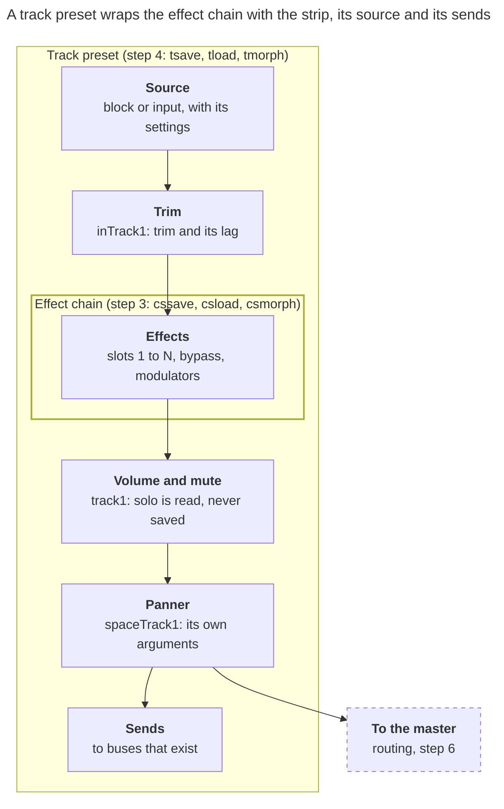

# Step 3 Design Note – Effect Chains and Strip Values

Nov 6, 2026 · @Federico

## Summary

Step 3 makes a strip's effect chain one unit you can save, load and morph with `cssave`, `csload` and `csmorph`, and puts the strip's own values (trim, volume, pan, mute) into the document. Track presets (`tsave`, `tload`, `tmorph`), which add those values, sends and the source, follow in step 4.

This follows the split agreed on 6 Nov, after looking at how DAWs do it: an effect-chain preset holds only the effects (like Logic's channel strip settings, Ableton racks, Reaper and Cubase FX chains); a track preset holds the whole channel (like Pro Tools track presets and Reaper track templates). The layers build up to scenes:

| Layer | Commands | Holds | Step |
| --- | --- | --- | --- |
| Effect | `fxsave` / `fxload` / `fxmorph` | one effect | 1, done |
| Block | `blksave` / `blkload` / `blkmorph` | one block | 2, done |
| Effect chain | `cssave` / `csload` / `csmorph` | the strip's effect slots, their modulators and bypass | 3 |
| Track | `tsave` / `tload` / `tmorph` | the chain, trim, volume, pan, mute, sends, the source and its settings | 4 |
| Scene | later | every track, the buses and the master | 7 |

Strip values go into the document now, without presets, so step 4 builds on values that are already read and checked. Commands people use today do not change, and faders stay as fast as now. The first PR (strip values in the document) does not depend on the questions at the end.

## A strip today

A strip is a chain of Ndefs: `inTrack1` (trim) → the effects `filterTrack_1_N` → `track1` (volume, mute, solo) → `spaceTrack1` (panner) → the master's input. Buses and the master are built the same way (`inBus1` … `spaceBus1`, `inMaster` … `spaceMaster`); the master has an extra `off` used by solo.

Its values are spread over Ndef arguments and lists in Assemblage that are kept by position:

| Value | Where it lives now | Set by |
| --- | --- | --- |
| trim (dB) and its lag | `Ndef('inTrack1')` args `trim`, `lagTime` | `trim`, trim knob |
| effects | `filters`, `tracks`, the effect Ndefs (already in the document) | `fx`, `fxset`, … |
| volume (dB) and its lag | `Ndef('track1')` args `volume`, `lagTime` | `vol`, fader, MIDI |
| mute | `Ndef('track1')` arg `mute` + `muteStates[i]` | `mute`, button |
| solo | `soloStates[i]` + the source of `Ndef('inMaster')` + the master's `off` | `solo`, button |
| pan (one or more, by panner) | `Ndef('spaceTrack1')` args, e.g. `pan` | `pan`, knob |
| modulators on trim, volume, pan | ModMap, mapped into those Ndefs | `modvol`, `modpan`, … |
| output (master or none) | `outputSettings[i]` | `out`, output menu |
| record arm | `recStates[i]` | `rec`, button |
| channels, panner type | `tracks`, `space`, fixed when the strip is made | `t add 2`, `start` |
| sends | `busArr`, the send Ndefs | `snd`, knobs |

`i` is the strip's position in `mixTrackNames`, which shifts when a track or bus is added or removed: the cause of several earlier bugs. The document keys strips by name instead.

## Strip values in the document

Each strip's address (`track1`, `bus2`, `master`) gains its own values beside the effects it already holds. In step 3 only the effect chain gets presets; the rest is in the document so step 4 can save it.



*Redrawn in Mermaid from the claude.ai version; the boxes and words are the same.* *The dashed box stays outside the preset.*

The effect chain is the step 3 preset; the track preset in step 4 wraps the chain with the strip's values, its source and its sends. The output to the master stays a session setting (step 6).

```
track1: (
	kind: \strip,
	channels: 1, space: \pan2,          // read only until #44
	trim: 0, volume: -6, mute: 0,
	pan: (pan: -0.3),                    // the panner's own arguments, by name
	lags: (volume: 2),                   // only lags that are not 0
	mods: (volume: (type: \sin, ...)),   // as for effects: by what they are
	fx: (1: (kind: \filter, def: \pch, ...), 2: (...)),   // the chain (step 1 units)
	solo: 0, output: \master,           // in the document, in no preset
	morphTime: 5                        // the chain's own, only when set
)
```

Rules, following steps 1 and 2:

- **Read from the running system.** Values are read from the Ndefs when the document is read, so a fader, knob, MIDI controller or IDE line needs no hook and stays as fast as now. Hooks only follow structure: a strip added or removed, an output, mute or solo changed.
- **Keyed by name, never by position.** `muteStates`, `soloStates` and `outputSettings` are read through `mixTrackNames` once per read, so a removed track cannot shift values onto its neighbour.
- **Pan by name.** `pan` holds the panner's own arguments (`pan2` has `pan`, `bal2` has `pos`, `panAz` has more), so nothing assumes a stereo pan.
- **The master** has the same fields except `solo` and `output`; its hardware outputs and limiter stay session settings (step 6).
- **Consistency check** as in step 1: after every test command, the document is compared with one built from scratch.

## Commands

`cssave` and `csload` keep their names, forms and meaning (they already save and load a strip's effect chain); they move to the new readable format and gain what effect presets gained in step 1.

| Command | What it does |
| --- | --- |
| `cssave t 1 warmVox` | track 1's effect chain → your presets (asks before replacing one) |
| `csload t 3 warmVox` | the chain onto track 3, whatever strip it was saved from (a bus or the master too) |
| `csload t 3 default` | an empty chain: every effect on track 3 removed |
| `csload` / `csload t` | lists chain presets |
| `csmorph t 3 warmVox [time] [xfade\|glide\|none]` | morphs track 3's chain to the preset (next section) |
| `csmorphtime t 3 5` | track 3's chain's own morph time; `csmorphtime t 3` posts it, `default` clears it |

- **What a chain preset holds:** each slot's effect unit as `fxsave` writes it (values, modulators, buffer or data by name), bypass, and the chain's morph time. Nothing outside the effects.
- **Where presets live:** `Settings/Presets/units/chain/<name>.scd` (and in libraries, as for effects).
- **Old presets:** effect-chain presets saved before this step still load, as old effect presets did in step 1.
- **Another strip:** addresses are rewritten (`track1` → `track3`); a chain with more channels than the target strip loads, and each effect adapts as it does when typed with `fx`.
- **Morph time:** the command's, else the preset's, else the chain's own, else the global `morphtime`, as for effects and blocks. The chain's own time needs a new command because `morphtime t 1 5` already asks for slot 5.

## Chain morph

`csmorph` compares the chain with the preset slot by slot and changes only what differs, all over the same morph time. These are the slot rules agreed on 2 Nov while building `fxmorph`.

| Slot | Difference | What happens |
| --- | --- | --- |
| same effect | other values | morphs as `fxmorph` does: xfade (default) or glide, modulators fading in and out |
| another effect | — | crossfade from the old effect to the new one |
| filled now | empty in the preset | the effect fades out, then is removed |
| empty now | filled in the preset | inserted silent, fades in |
| any | bypass differs | follows the preset, fading in or out |
| any | the same | untouched |

- **Shape:** `xfade` or `glide` applies to slots with the same effect; `none` jumps to the preset at once.
- **One morph per chain:** a new `csmorph` or `csload` on the same strip stops the running one where it is, as `fxmorph` does.
- **A command during a morph** wins for what it sets; the rest of the morph continues.
- **CPU:** only differing slots crossfade, so a chain of four effects with one changed slot doubles one effect for the morph time, not four.

## Tests, timing and risks

**Done when**

- Strip values: the consistency check agrees across the whole suite, including tests that add and remove tracks and buses, set mute, solo, pan on different panners, and modulate volume.
- Chains: round trips identical (save, change, load) for a mono track, a stereo track, a bus and the master, each with two effects, a modulator and a bypassed slot; a chain from track 1 loads onto track 3 and onto a bus; an old effect-chain preset still loads.
- `csmorph`: every row of the slot table has a test, plus a morph interrupted by a command and by another morph.
- Timing: `vol`, `pan` and `trim` take the same time as on `dev` (no hook on them); reading the document with 8 tracks, 2 buses and 10 effects is measured and stays well under a second.
- The mixer tests pass on the Mac, and you try a chain morph by ear.

| Risk | What we do |
| --- | --- |
| Lists kept by position (`muteStates`, `soloStates`, `outputSettings`) shift when a strip is removed | read them by name once per read; a test removes a middle track and checks its neighbours |
| Panner types differ between strips | pan stored by argument name, so step 4 can match or skip it |
| #44 changes channels and panners later | `channels` and `space` are read only now |
| A morph of many slots costs CPU | only differing slots crossfade; measured on the Mac with four effects |
| The mixer window's effect slots show the old chain after `csload` | load through the same functions `fx` and `clearfx` use, which already update the window |

## PR plan

Three PRs into `dev`, each with its tests, a full cloud run and a Mac run of the mixer tests:

1. **Strip values in the document:** trim, volume, pan, mute, solo, output, lags and mixer modulators read from the running system, hooks for strips added and removed, the consistency check across the suite. No visible change; does not depend on your answers.
2. **Chain presets:** `cssave` / `csload` in the new format, `default`, the list, loading onto another strip, old presets still loading.
3. **Chain morph:** `csmorph` and `csmorphtime`, the slot rules, a morph interrupted by a command or another morph.
4. **Mixer window (question 3):** dropped; the chain menu comes with step 5.

## Step 4 outline: track presets

Step 4 gets its own design note; this is what step 3 prepares for.

- **`tsave` / `tload` / `tmorph`** (and tmorphtime, a track's own morph time) for tracks, buses and the master (`tsave b 1 …`). A track preset holds the chain (in the same form as a `cssave` file), trim, volume, pan, mute, the mixer modulators, the sends, and the source's units (in the form `blksave` writes; a list, so points can join later). A bus has no source; the master has no source and no sends.
- **Sends:** a send to bus 2 is reconnected only if the target session has a bus 2; otherwise it is skipped and named. Making buses is a session job (step 6).
- **The source's buffer:** a sound file comes back by name and folder, as `blkload` does; a recording only if it was kept with `keep`.
- **Choosing what to load,** as in Pro Tools: `tload t 1 name nosrc` or `nofx`, reusing the pieces below.
- **Pan across panners:** carried by argument name; skipped and named when the target's panner has no such argument.
- **`tmorph`:** the chain morphs as `csmorph`; volume, pan and trim glide; the source morphs as `blkmorph`, or crossfades if it is a different block; mute switches at the start (unmute) or the end (mute).
- **Never in a preset:** solo (it silences other strips), record arm, and the output to the master (routing, step 6).

## Decisions (6 Nov)

- **`csload t 1 default`** removes every effect on the strip (an empty chain).
- **Master chains** load onto tracks and buses and the other way round, like any chain.
- **Mixer window:** no chain menu now; it comes with step 5, when the mixer is rebuilt as a client. PR 4 is dropped.
- **Names:** `cssave`, `csload`, `csmorph`, `csmorphtime` now; `tsave`, `tload`, `tmorph` and `tmorphtime` in step 4.
